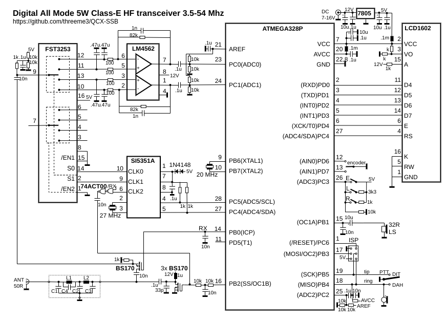
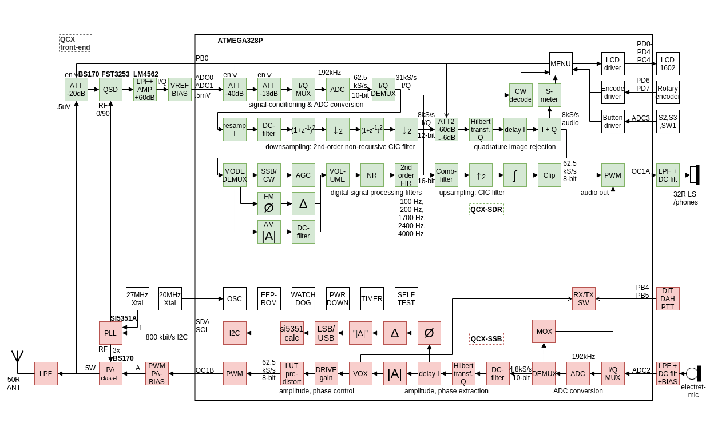

# uSDX Plus Orange: micro Software Defined Transceiver

**Firmware:** modular production release `v2.1.0` (single sketch in the project root) — strict parity with the legacy reference firmware it was rebuilt from (see `AGENTS.md`).

**uSDX Plus Orange** is a modular rebuild of the uSDX firmware (PE1NNZ original, GW8RDI WhiteButtons lineage), maintained by **EA7LJY**. QRP SSB/CW/AM/FM transceiver on ATMEGA328P (2KB RAM, 32KB flash) with class-E EER transmit stage (~5W PEP) and SDR receiver (Tayloe detector + Hilbert transform).

> **⚠️ After flashing:** Power off, then power on while holding the **encoder button (menu)** to reset EEPROM to factory defaults. This ensures all settings are initialized correctly.

## Firmware layout (project root = Arduino sketch)

The folder name must match the main file (`usdx_plus_orange/` → `usdx_plus_orange.ino`).

| File | Contents |
|------|----------|
| `usdx_plus_orange.ino` | setup()/loop(), menu engine, UI |
| `usdx_settings.h` | Only configuration (WHITE_BUTTONS model + features) |
| `hw.h` | Pins, ADC, timers, ISRs, RX/TX switching |
| `rx.h` | RX DSP chain (CIC, Hilbert, demod, AGC, NR, filters) |
| `tx.h` | TX modulator `ssb()`, CW, LUT, VOX |
| `cw.h` / `cat.h` / `vfo.h` / `menu.h` | Keyer + decoder, CAT TS-480, VFO A/B + RIT/Split, declarative menu |
| `display.h` / `i2c.h` / `si5351.h` / `lpf.h` / `perf.h` | LCD + encoder, bit-bang I2C, SI5351, LPF board, CPU meter |
| `usdx_filter.h` | SSB/CW IIR filters |
| `tests/` | Host parity harnesses (no hardware needed) |
| `tools/` | Flash/RAM size tracking per build |
| `usdx-legazy/` | Read-only reference firmware (parity source of truth). **Not distributed in this repository**: the parity tests need a local copy |
| `usdx-lab/` | Lab firmware: copy + ADC/audio instrumentation, no CAT (see `usdx-lab/README_LAB.md`) |

Docs: `AGENTS.md` (parity contract, build, tests), `ROADMAP.md` (improvement plan), `HARDWARE_TEST_GUIDE.md` (flashing + hardware checks).

### Build

```bash
arduino-cli compile --fqbn arduino:avr:uno .
# Sketch uses 30788 bytes (95%) flash, 1188 bytes (58%) RAM, 0 warnings
```

### Tests (host, no hardware)

```bash
./tests/run_all.sh [--build] [--avr]   # every host test (+ builds, + full radio in simavr)
```

Individual parity tests (they need the legacy reference in `usdx-legazy/`):

```bash
cd tests/parity_tx
python3 gen_parity_tx.py
gcc -O0 -o parity_tx main_test_tx.c tx_legacy.c tx_v2.c -lm && ./parity_tx
cd ../parity_rx
python3 gen_parity_rx.py
gcc -O0 -o parity_rx main_test_rx.c rx_legacy.c rx_v2.c -lm && ./parity_rx
cd ../ab_agc && ./run_ab_agc.sh
```

TX `ssb()` is bit-exact vs legacy; RX core, filters and AGC report 0 mismatches (NR levels ≥2 differ intentionally — noise-gate NR improvement, see `ROADMAP.md`).

---

## Recommended settings

### TX (SSB voice)

| Menu | Value | Benefit |
|------|-------|---------|
| 20 TX Drive | 4–6 | ~5W PEP; start low, raise while watching SWR |
| 28 Mic Atten | 0 | 6 dB/step attenuator; raise only if mic clips |
| 30 TX Comp | 1–2 | Speech processor (envelope clipping after the ALC): about +3 / +5 / +6 dB average talk power at 1 / 2 / 3, at the cost of in-band IMD. 0 = cleanest signal |
| 31 TX LoCut | 2 (200 Hz) | Removes sub-audio rumble; saves power and IMD |
| 29 DIGI Mode | ON for digital | Flat TX path (USB + VOX + full bandwidth set manually) |
| 23/24 PA Bias | Calibrate | PWM range where the PA starts / max power |
| 34 TX EnvPre | 0 until measured | Envelope pre-emphasis for the RC shaper before the PA gates: IMD3 −20 → −32 dBc at 2 (simulated). Worse if your board lacks that RC: set it with a two-tone test |

### RX

| Menu | Value | Benefit |
|------|-------|---------|
| 7 AGC | Fast (SSB) / Slow (CW) | Fast = legacy response; Slow = stable CW level |
| 32 AGC Start | ON | Instant audible gain on band start (x8 preload) |
| 33 AGC Hang | 5 (with AGC Slow) | Holds the gain 0.4 s after speech: no noise pumping between words, weak signals back in ~1 s. Only acts on AGC Slow |
| 8 NR | 2–4 (SSB/CW) | Noise gate relative to the tracked noise floor: 6/12/18/24 dB less noise in pauses and on an empty band, voice untouched. Signals within ~10 dB of the noise and steady carriers (after 2–3 s) are attenuated too: turn it off for weak DX and digital modes |
| 9/10 ATT/ATT2 | 0 to start | Raise if strong signals overload the front end |
| 11 S-meter | S or dBm | Signal indicator |

---

## Menu (35 entries)

| Id | Item | Range |
|----|------|-------|
| 0 | Volume | -1–16 (turn left at 0 = power off/on) |
| 1 | Mode | LSB, USB, CW, FM, AM |
| 2 | Filter BW | Full, 3000, 2400, 1800, 500, 200, 100, 50 Hz |
| 3 | Band | 160, 80, 60, 40, 30, 20, 17, 15, 12, 10, 6 m |
| 4 | Tune Rate | 10M, 1M, 0.5M, 100k, 10k, 1k, 0.5k, 100, 10, 1 |
| 5 | VFO Mode | A, B (+Split via long press) |
| 6 | RIT | ON, OFF |
| 7 | AGC | OFF, Fast, Slow |
| 8 | NR | 0–8 |
| 9 | ATT | 0, -13, -20, -33, -40, -53, -60, -73 dB |
| 10 | ATT2 | 0–16 (digital, 6 dB/step) |
| 11 | S-meter | OFF, dBm, S, S-bar, wpm |
| 12 | CW Decoder | ON, OFF |
| 13 | Semi QSK | ON, OFF |
| 14 | Keyer Speed | 1–60 WPM |
| 15 | Keyer Mode | Iambic A, Iambic B, Straight |
| 16 | Keyer Swap | ON, OFF |
| 17 | Practice | ON, OFF (TX disabled) |
| 18 | VOX | ON, OFF |
| 19 | Noise Gate | 0–255 |
| 20 | TX Drive | 0–8 (8 = constant envelope) |
| 21 | CQ Interval | 0–60 s |
| 22 | CQ Message | Text (48 chars) |
| 23 | PA Bias min | 0–254 |
| 24 | PA Bias max | 1–255 |
| 25 | Ref freq | 14–28 MHz (crystal calibration) |
| 26 | IQ Phase | 0–180° |
| 27 | Backlight | ON, OFF |
| 28 | Mic Atten | 0–4 (6 dB/step) |
| 29 | DIGI Mode | ON, OFF |
| 30 | TX Comp | 0 (off), 1, 2, 3 |
| 31 | TX LoCut | OFF, 100, 200, 400 Hz |
| 32 | AGC Start | ON, OFF |
| 33 | AGC Hang | 1–8 (1 = legacy; each step ≈ 0.1 s) |
| 34 | TX EnvPre | 0 (off), 1, 2, 3 |

Shortcuts (L=left, E=encoder, R=right): **E+turn** volume · **R** mode · **R double** filter · **E double** band · **E / E long** step · **2x R long** VFO · **R long** RIT · **L** menu · **L+turn** quick menu · **R** back · **E long at power-up** factory reset.

For SSB voice connect an electret mic to the paddle jack (DOT = PTT, DASH = audio). For digital modes set USB + VOX + full bandwidth manually, feed audio in/out via the jacks, and enable 29 DIGI Mode.

---

## Features in this firmware

- Bit-exact parity with the verified legacy reference (see tests above)
- Menu-switchable improvements, all defaulting to legacy behavior: mic attenuator, DIGI flat path, envelope-clipping speech processor (TX Comp), TX low-cut, TX envelope pre-emphasis (TX EnvPre), NR noise gate, AGC fast-start / anti-pumping hang / Slow (M0PUB) mode
- Always on (bit-exact or measured better than legacy): fixed-point S-meter, fast exact SI5351 calc, peak TX ALC, directional band change
- Full CAT TS-480 subset, VFO A/B + RIT/Split, Iambic-A/B/Straight keyer + CW decoder + CQ messages, procedural menu with EEPROM persistence

Details and measurements: `ROADMAP.md`. Hardware validation: `HARDWARE_TEST_GUIDE.md` + `usdx-lab/GUIA_TEST_HW.md`.

---

## Revision History

| Rev. | Date | Features |
|------|------|----------|
| v2.0.0 | 2026-09-15 | Modular production release at project root (parity-verified); `usdx-lab/` instrumented copy for hardware tests. |
| v2.1.0 | 2026-10-15 | Fixes found with the AVR simulator (`F_CPU`/timers, S-meter, PB3, TX ISR load); TX Comp, NR and AGC Hang redone and measured; new TX EnvPre; CQ Message trigger fixed. **EEPROM resets to factory defaults on first boot.** |

Lineage: PE1NNZ original uSDX → GW8RDI WhiteButtons → modular parity rebuild (this firmware).

---

## Schematic / Hardware




uSDX hardware variants (Sandwich by DL2MAN, WB2CBA transceiver and others) are discussed in the [uSDX Forum]. Firmware upload: compile in Arduino IDE (`Arduino Uno` board) or flash via ISP; the radio runs the MCU at 20 MHz external — see `HARDWARE_TEST_GUIDE.md` for fuses and flashing. **TX tests always into a 50 Ω dummy load.**

## Credits

Original uSDX concept, circuit and code by _Guido (PE1NNZ)_; sandwich PCB and class-E LPF by _Manuel (DL2MAN)_. This modular firmware maintained by **EA7LJY**.

## License

MIT — see [`LICENSE`](LICENSE). Includes the original copyright and permission notice of Guido PE1NNZ (QCX-SSB / uSDX), from which this firmware derives.

[uSDX Forum]: https://groups.io/g/ucx
